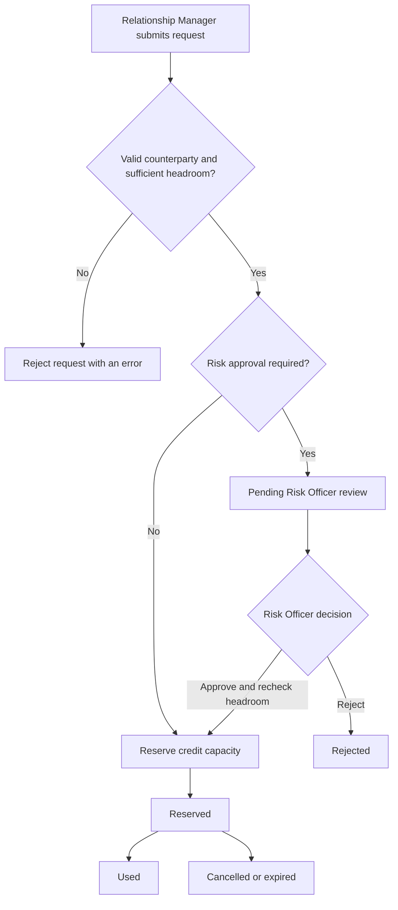

# LimitGuard

### Counterparty Credit Limit & Exposure Management Platform

**A full-stack Java and React application that models how a financial institution can set credit limits, track exposure, and control credit requests through a risk-approval workflow.**

LimitGuard was built as a Java/Spring Boot software engineering project. It is designed to make an unfamiliar banking process understandable through clear business rules, secure APIs, and an interactive dashboard.

> **Project scope:** LimitGuard is an educational, fictional simulation inspired by common banking risk-and-control concepts. It is not affiliated with any institution's internal credit policies. Demo users, transactions, and financial data are synthetic. Some demo institution names are real.

## Initialize a fresh PostgreSQL database

Run from the repository root with a PostgreSQL role that can create a database. Use your normal PostgreSQL authentication setup.

```sh
export DB_USERNAME='your_local_database_role'
export LIMITGUARD_NEW_DB='limitguard_fresh'

createdb --host=127.0.0.1 --port=5432 --username="$DB_USERNAME" "$LIMITGUARD_NEW_DB" &&
  psql -X --host=127.0.0.1 --port=5432 --username="$DB_USERNAME" \
    --dbname="$LIMITGUARD_NEW_DB" --set=ON_ERROR_STOP=1 --file=database/schema.sql
```

After initialization succeeds, set `DB_URL` to `jdbc:postgresql://127.0.0.1:5432/limitguard_fresh` for Auth, Credit, and Activity. Supply `DB_USERNAME` and `DB_PASSWORD` through the service environment as required. The [shared PostgreSQL bootstrap guide](docs/DATABASE_BOOTSTRAP.md) lists the service startup commands and schema checks. All three services keep Hibernate in `validate` mode.

## The idea, in plain English

Imagine a bank agrees that it can take on up to **BD 1,000,000** of credit exposure to a particular company. The bank needs to know how much of that allowance is already used, how much is reserved for upcoming activity, and how much remains available.

LimitGuard keeps track of these amounts and helps prevent requests that exceed the approved limit. Some requests can be reserved directly; others must be reviewed by a Risk Officer. If a company becomes too risky, the Risk Officer can freeze or close its status so no new credit requests are accepted.

### A quick example

| Item | Amount |
| --- | ---: |
| Approved credit limit | BD 1,000,000 |
| Already used | BD 300,000 |
| Reserved for approved activity | BD 200,000 |
| **Available headroom** | **BD 500,000** |

**Available headroom = Approved limit − Used exposure − Reserved exposure.**

A new request for BD 600,000 would exceed the available headroom and must not be allocated. A request that needs approval does not consume headroom merely because it was submitted; headroom is checked again before approval reserves it.

## Banking terms made simple

| Term | What it means in LimitGuard |
| --- | --- |
| **Financial institution** | The bank or financial organisation managing credit exposure. |
| **Counterparty** | The company or organisation on the other side of a financial relationship or transaction. In this demo, it is the company the bank is monitoring. |
| **Credit limit** | The maximum approved exposure a bank can have to a counterparty within a specific bank–counterparty relationship. |
| **Exposure** | The amount of financial risk currently taken or allocated under a limit. |
| **Used exposure** | Credit capacity that has already been used. |
| **Reserved exposure** | Credit capacity set aside for an approved request that has not yet been used. |
| **Headroom** | The remaining capacity under a credit limit. |
| **Credit request** | A request to use or reserve part of a counterparty's credit limit. |
| **Relationship Manager (RM)** | A bank employee who manages business relationships and submits credit requests. |
| **Risk Officer** | A bank employee who reviews higher-value requests and can approve, reject, freeze, or close relevant relationships. |
| **Maker-checker** | A control that separates the person requesting an action from the person approving it. |
| **Audit log** | A record of important actions, who performed them, and when. |

## Main features

- **Authentication and accounts:** JWT-based login, registration, email verification, password reset/change, and user profile management.
- **Role-based access control:** `RELATIONSHIP_MANAGER`, `RISK_OFFICER`, and `ADMIN` have different permitted actions, enforced by Spring Security on the backend.
- **Counterparty management:** Create, view, search, and update counterparties; use `ACTIVE`, `FROZEN`, and `CLOSED` statuses to control new activity.
- **Credit limits and headroom:** Maintain approved limits and track used, reserved, and remaining amounts.
- **Credit request lifecycle:** `PENDING_APPROVAL`, `RESERVED`, `USED`, `REJECTED`, `CANCELLED`, and `EXPIRED`.
- **Approval controls:** Risk Officer review, maker-checker restrictions, and a fresh headroom check when approving a request.
- **Auditability and notifications:** Audit logs, email notifications, and Server-Sent Events (SSE) for live credit-request updates.
- **REST API documentation:** Swagger UI / OpenAPI.
- **Frontend workspace:** React/TypeScript screens for credit requests, counterparties, exposure, and administration.
- **Development seed data:** Fictional banking records for local development. The original development seeders are opt-in; see the seed-plan status below before enabling them.
- **Corporate group limits:** Connected companies share institution-specific group capacity, checked alongside individual headroom.
- **ML risk analytics:** Six-ratio company profiles, a Python FastAPI inference service, and parallel group assessments.
- **Concurrency controls:** Transactional database row locks protect request decisions and credit exposure during overlapping operations.
- **Asynchronous processing:** A configured executor supports notification delivery; SSE provides live status updates.

### Counterparty statuses

| Status | Meaning |
| --- | --- |
| `ACTIVE` | New credit requests may be submitted if other rules pass. |
| `FROZEN` | New credit requests are blocked while existing history is retained. |
| `CLOSED` | New credit requests are blocked; historical records remain available. |

### Credit request workflow



The current demonstration rule uses a value threshold to route larger requests for approval. This is a **project-specific example**, not a claim about any bank's actual policy.

## Technology stack

| Layer | Technologies |
| --- | --- |
| Backend | Java 17, Spring Boot, Spring Web MVC, Spring Data JPA, Hibernate |
| Security | Spring Security, JWT, BCrypt, method-level authorization |
| Database | PostgreSQL; H2 for isolated tests |
| Frontend | React, TypeScript, Vite |
| API documentation | Springdoc OpenAPI / Swagger UI |
| Testing | JUnit, Spring test tooling, Vitest, Playwright |
| Developer tools | IntelliJ IDEA, pgAdmin, Postman, Git, GitHub, Jira |
| Notifications | PostgreSQL outbox, Kafka, Server-Sent Events, optional Spring Mail / SMTP |
| Risk analytics | Python FastAPI inference integration, Java parallel assessment service |
| Concurrency | Spring transactions, JPA pessimistic database locks, configured executors |

## Architecture

The React client talks to the API Gateway. Auth, Credit, and Activity share one PostgreSQL database and the `public` schema.

```text
React / Vite → API Gateway
                ├─ Auth → PostgreSQL
                ├─ Credit → PostgreSQL + Python ML
                └─ Activity → SSE stream back to React

Credit transaction → PostgreSQL notification outbox → Kafka → Activity
                                                               ├─ SSE
                                                               └─ Optional email queue → SMTP
```

- **Auth** handles accounts, JWTs, SSO, institution data, and profile pictures.
- **Credit** owns banking workflows, limits, exposure, and parallel ML assessments. It checks the caller's authorization with Auth. The Python service performs experimental inference through `POST /predict`.
- **Activity** checks subscriptions with Auth, consumes Kafka notifications, and delivers institution-scoped SSE. Its email consumer and delivery worker are separately configurable and disabled by default.
- **PostgreSQL** stores banking records, the notification outbox, and email delivery records. Auth and Credit save audit records directly to the shared `audit_logs` table. Kafka carries notifications.

### Entity relationship diagram (ERD)

The original diagram is a historical reference. See the [current schema inventory](docs/DATABASE_BOOTSTRAP.md#schema-inventory) for the shared database layout.

**[View the LimitGuard ERD on dbdiagram.io](https://dbdiagram.io/d/6abcbefa0f25a52d014bf6d3)**

## Roles and responsibilities

| Role | Main responsibilities |
| --- | --- |
| **Relationship Manager** | View permitted credit information; create and manage their permitted credit requests. |
| **Risk Officer** | Review and decide requests requiring approval; manage counterparties and credit limits as authorized. |
| **Admin** | Manage permitted user and administrative functions; does not automatically receive Risk Officer approval authority. |

Authorization is checked in the backend. Hiding a button in the frontend is **not** considered a security control.

## Running the project locally

### 1. Prepare dependencies and service configuration

Install JDK 17, PostgreSQL, Kafka, Node.js with npm, and Python with virtual-environment support. Each Java module includes a Maven wrapper. Use a local PostgreSQL database initialized with the [fresh-database procedure above](#initialize-a-fresh-postgresql-database), or an existing initialized development database. A fresh schema contains no accounts or demo data.

Start PostgreSQL and Kafka first. For a schema-only smoke test, follow the bootstrap guide instead of starting the normal notification and scheduling processes. Credit and Activity use `KAFKA_BOOTSTRAP_SERVERS` (default `localhost:9092`). On a fresh local broker, create `credit-request-events` once using the Kafka CLI:

```sh
kafka-topics.sh --bootstrap-server "${KAFKA_BOOTSTRAP_SERVERS:-localhost:9092}" \
  --create --if-not-exists --topic credit-request-events --partitions 1 --replication-factor 1
```

Supply secrets through each service's run configuration or shell environment. In separate terminals, make sure the variables are available to each process.

- **Auth, Credit, Activity:** `DB_URL` (default `jdbc:postgresql://localhost:5432/limitguard`), `DB_USERNAME` (default `postgres`), and `DB_PASSWORD`. All three use Hibernate `validate`.
- **Auth and Credit:** use the same `JWT_SECRET`. **Auth, Credit, and Activity** must share the same `INTERNAL_SERVICE_KEY`. Credit and Activity call Auth on port 8081 by default.
- **Auth SMTP:** Auth needs a mail sender to start. The command below points it at a loopback SMTP sink on port 1025. If testing registration or password recovery, start the sink first. For an explicitly configured Gmail test, Auth's `dev` profile reads `GMAIL_USERNAME` and `GMAIL_APP_PASSWORD`. Configure `PROFILE_PICTURE_DIRECTORY` if images are stored outside the checkout.
- **Activity email:** keep `ACTIVITY_EMAIL_CONSUMER_ENABLED` and `ACTIVITY_EMAIL_DELIVERY_ENABLED` false during ordinary startup. The sample command scopes empty Gmail values to Activity with email disabled. Before enabling email separately, configure SMTP and the shared `ACTIVITY_NOTIFICATION_RECIPIENT_KEY`, and review the email consumer group's offsets and pending queue. The email group defaults to `limitguard-activity-email-v1` and uses `latest` when no usable offset exists.

### 2. Start the services

Run each line in a separate terminal from the repository root and wait for startup before moving to the next dependent service. **Port 8080 belongs to the API Gateway.** The root Maven module is the original monolith.

1. Start Auth on **8081**.

   ```sh
   (cd auth-service && SPRING_MAIL_HOST=127.0.0.1 SPRING_MAIL_PORT=1025 ./mvnw spring-boot:run)
   ```

2. Start the ML API on **8000** for individual and group predictions. Credit can start before ML, but predictions require it. Check `GET /health` for `modelLoaded: true` before running assessments.

   ```sh
   cd ml-service
   python3 -m venv .venv
   .venv/bin/python -m pip install -r requirements.txt
   .venv/bin/python -m uvicorn main:app --host 127.0.0.1 --port 8000
   ```

3. Start Credit on **8082**, then Activity on **8083**. Credit's checked-in configuration enables the outbox relay, reservation expiry, and exposure snapshots. The scheduler scans reservations every 60 seconds. Snapshot capture runs on startup and is attempted hourly on UTC boundaries. Use the [bootstrap guide's smoke-test commands](docs/DATABASE_BOOTSTRAP.md#verify-service-startup) for schema validation with background jobs disabled.

   ```sh
   (cd credit-service && ./mvnw spring-boot:run)
   ```

   ```sh
   (cd activity-service && ACTIVITY_EMAIL_CONSUMER_ENABLED=false ACTIVITY_EMAIL_DELIVERY_ENABLED=false \
     GMAIL_USERNAME= GMAIL_APP_PASSWORD= ./mvnw spring-boot:run)
   ```

4. Start the Gateway on **8080** after its downstream services are ready.

   ```sh
   (cd api-gateway && ./mvnw spring-boot:run)
   ```

On Windows, run the commands from the respective module directories using `.\mvnw.cmd`, set environment variables in PowerShell, and use `.venv\Scripts\python.exe` for the ML commands.

### 3. Start the frontend

```sh
cd frontend
npm ci
npm run dev
```

Open [LimitGuard locally](http://127.0.0.1:5173). The browser uses relative `/api` URLs and Vite proxies them to `http://localhost:8080` by default. For another local Gateway address set `API_PROXY_TARGET` before starting Vite. If using SSO, open the public frontend origin configured by Auth’s `limitguard.sso.frontend-url` so the provider callback and exchange use the same browser session.

### 4. Explore the API

- [Auth Swagger UI](http://localhost:8081/swagger-ui/index.html) and [Auth OpenAPI JSON](http://localhost:8081/v3/api-docs)
- [Credit Swagger UI](http://localhost:8082/swagger-ui/index.html) and [Credit OpenAPI JSON](http://localhost:8082/v3/api-docs)
- [Activity SSE API reference](docs/ACTIVITY_SSE.md) for `GET /api/credit-requests/events`

Gateway routes Auth users, SSO and institution paths to Auth, and the banking APIs to Credit. The exact SSE `GET` route has priority over Credit's broader request route. Gateway leaves Auth's internal routes and service-local Swagger endpoints unexposed.

### 5. Run tests

Run Maven tests from the service module you are testing. Check database-backed test prerequisites before running a suite. In particular, `CreditRequestConcurrencyIntegrationTest` uses `CREDIT_EXPIRY_TEST_JDBC_URL` pointing to a dedicated loopback PostgreSQL database named `limitguard_expiry_test` on a non-default port. It creates and drops its test schema on that database.

```sh
(cd credit-service && ./mvnw -Dtest=GroupExposureBreakdownTest test)
(cd frontend && npm test)
```

Run `npm run test:browser` from `frontend` against a configured safe test environment. The root `./mvnw test` runs the monolith suite.

## API overview

Some representative backend routes:

| Method | Route | Purpose |
| --- | --- | --- |
| `POST` | `/api/auth/users/register` | Register an account |
| `POST` | `/api/auth/users/login` | Authenticate |
| `GET` | `/api/auth/users/profile` | Read current user's profile |
| `POST` | `/api/credit-requests` | Submit a credit request |
| `GET` | `/api/credit-requests/events` | Subscribe to [Activity SSE](docs/ACTIVITY_SSE.md) |
| `GET` | `/api/credit-requests/my` | List permitted personal requests |
| `GET` | `/api/credit-requests/pending` | View requests awaiting review |
| `GET` | `/api/credit-requests/{creditRequestId}/review` | View a request's approval context |
| `PATCH` | `/api/credit-requests/{creditRequestId}/approve` | Approve an eligible request |
| `PATCH` | `/api/credit-requests/{creditRequestId}/reject` | Reject an eligible request |
| `PATCH` | `/api/credit-requests/{creditRequestId}/use` | Mark a reserved request as used |
| `PATCH` | `/api/credit-requests/{creditRequestId}/cancel` | Cancel an eligible request |

For request bodies, validation requirements, and the full set of endpoints, use Swagger UI or [`frontend/API_CONTRACT.md`](frontend/API_CONTRACT.md).

## Planning and project management

Development was organised into Jira stories and incremental milestones, covering authentication, data modelling, credit limits, request workflows, approvals, auditability, testing, and frontend integration.

**[View the LimitGuard Jira board](https://aliaburashid.atlassian.net/jira/software/projects/LG/boards/1/backlog?epics=visible&jql=parent%20IN%20%28LG-11%2C%20LG-5%2C%20LG-9%2C%20LG-8%29&selectedIssue=LG-7)**

> Jira may require permission or sign-in. The link is provided as a project-planning reference.

## My learning experience

### Favourite part: following a clear architecture

My favourite part of building LimitGuard was having a clear architecture to follow. Separating the project into controllers, services, repositories, entities, and DTOs made the development process much easier to understand. Once I understood how a request moves through these layers, I could focus on one responsibility at a time instead of trying to solve the entire project at once. This structure also made debugging and adding new features more manageable.

### Biggest challenge: learning the business language

The most challenging part at the beginning was understanding the financial terminology behind the project. Terms such as *counterparty*, *credit exposure*, *reserved amount*, *headroom*, and *maker-checker* were new to me. I needed to understand what each concept meant before I could translate it into meaningful Java business rules. Working through examples, mapping the database relationships, and testing the request lifecycle helped me connect the banking concepts to the code.

### What I learned

LimitGuard strengthened my understanding of layered backend architecture, relational data modelling, authentication and authorization, state transitions, transactional business rules, API documentation, and testing. It also taught me that understanding the **business problem** is just as important as writing the code.

## Future improvements

These are potential next steps, **not claims about features already delivered**:

- **Stronger institution isolation:** consistently scope all relevant API queries, approval actions, exposure calculations, and SSE notifications to the authenticated user's institution.
- **Richer dashboards:** institution-scoped portfolio totals, utilization trends, concentration views, and drill-down reports.
- **More intuitive selection:** searchable counterparty and credit-limit pickers with names rather than internal IDs.
- **More comprehensive testing:** cross-institution security tests, concurrency tests for simultaneous reservations, and end-to-end approval scenarios.
- **Advanced risk controls:** configurable approval thresholds, expiry policies, and exposure warnings.
- **Deployment:** Docker packaging, CI/CD automation, and AWS hosting are future work. The current runbook starts the services directly on the local machine.

## References and learning resources

These are **technical documentation and learning resources**, not endorsements or evidence of real-world bank policy:

- [Spring Boot Reference Documentation](https://docs.spring.io/spring-boot/reference/)
- [Spring Security Reference](https://docs.spring.io/spring-security/reference/)
- [Spring Data JPA Reference](https://docs.spring.io/spring-data/jpa/reference/)
- [PostgreSQL Documentation](https://www.postgresql.org/docs/)
- [Spring Framework — Email Integration](https://docs.spring.io/spring-framework/reference/integration/email.html)
- [Spring Boot — Sending Email](https://docs.spring.io/spring-boot/reference/io/email.html)
- [Google Account Help — Sign in with app passwords](https://support.google.com/accounts/answer/185833)
- [MDN — Using Server-Sent Events](https://developer.mozilla.org/en-US/docs/Web/API/Server-sent_events/Using_server-sent_events)
- [OpenAPI Specification](https://spec.openapis.org/oas/latest.html)
- [OWASP — Access Control Cheat Sheet](https://cheatsheetseries.owasp.org/cheatsheets/Authorization_Cheat_Sheet.html)

## Project note

This repository is a portfolio/learning project using fictional demonstration data. It should not be used to make real lending, counterparty-risk, or regulatory decisions without appropriate domain review, additional controls, and production-grade validation.


---

## Unit 3: Concurrency, connected counterparties and risk analytics

Unit 3 introduced concurrency and risk analytics in the original application. Credit Service now owns those workflows. The key business problem is that **two employees can act on the same credit request or shared credit capacity at nearly the same time**. A banking system must not approve a request twice, reserve the same headroom twice, or let different subsidiaries collectively exceed their group's approved limit.

For a full explanation, including transaction sequences and presenter walkthroughs, see **[Concurrency & demonstration scenarios](docs/CONCURRENCY.md)**.

### New and extended business capabilities

| Capability | Implementation | Business purpose |
| --- | --- | --- |
| Connected counterparties | `CorporateGroup`, `CorporateGroupMembership` | Associate subsidiaries with one parent group |
| Shared group capacity | `GroupCreditLimit` and group-aware reservation checks | Prevent combined subsidiary exposure from exceeding a bank's group limit |
| Financial risk inputs | `CounterpartyFinancialProfile` | Store six financial ratios and a financial-year-end date |
| ML predictions | Java ML service → Python FastAPI model | Provide additional risk context for authorized company assessments |
| Parallel group assessments | `ParallelRiskAssessmentService` using an executor | Assess multiple subsidiaries without requiring sequential external calls |
| Thread-safe decisions | `@Transactional` and pessimistic JPA row locks | Serialize competing decisions and exposure changes |
| Async notifications | PostgreSQL outbox, Kafka, and Activity SSE or optional SMTP | Notify relevant sessions after state changes without tying email work to the main request |
| Frontend | React dashboard, risk analytics, group views and notifications | Make banking and concurrency workflows observable |

**Model scope:** The current ZIP contains 12 JPA entities. `GroupExposureSnapshot` and `GroupLimitBreach` were discussed in design notes but are **not present as JPA entities** in this version; do not describe them as implemented.

### Shared group headroom

A company's individual limit is not enough on its own. When the company belongs to a corporate group with a limit at the same bank, the system must also respect:

`Group headroom = Group approved limit − sum(member used exposure + member reserved exposure)`

For example, if Arabian Energy Group has **BD 800,000** of group headroom and two RMs concurrently submit **BD 450,000** requests for different subsidiaries, the first successful reservation leaves **BD 350,000**. The second cannot reserve another BD 450,000. Both requests are below the application's BD 500,000 immediate-reservation threshold.

### Race condition and thread-safety approach

The primary scenario is **two Risk Officers approving the same pending BD 600,000 request**. Without a transactionally protected request state, both might observe `PENDING_APPROVAL` and try to reserve credit or record a decision.

LimitGuard uses database-backed **pessimistic write locks** to serialize competing updates to the request and affected credit capacity. After the first transaction commits, the waiting transaction must re-evaluate the current status and cannot approve a request that is no longer pending. Database locks were chosen over a Java-only `ReentrantLock` because they coordinate access through the shared PostgreSQL database, including across different application instances.

The existing `Thread.sleep(5000)` inside approval is a **demonstration delay**, not the safety mechanism. The transaction and locks are what protect consistency.

Other important scenarios include approval versus rejection, simultaneous reservations on one facility, different subsidiaries competing for a shared group limit, duplicate cancellation, reservation versus usage, and scheduler expiry versus usage. The precise business rule and expected outcome for each are documented in [docs/CONCURRENCY.md](docs/CONCURRENCY.md).

### Parallel ML assessment and interpretation

`CounterpartyFinancialProfile` stores six inputs: return on assets, profit margin, fixed asset turnover, debt-to-total-capital percentage, interest coverage, and total debt-to-EBITDA. The Java ML integration sends authorized company inputs to the Python FastAPI prediction endpoint. A parallel assessment service coordinates multiple predictions and reports per-company success or failure.

**Experimental decision support.** The current class-1 probability is not a verified probability of default. The supplied artifacts identify class 1 numerically but do not define its business outcome or prediction horizon. Risk Officers can use the output as additional context. Credit decisions continue to follow the existing banking rules.

- **Unreachable risk bands.** The fitted logistic regression and its numeric scoring bins produce class-1 probabilities from approximately **1.7344% to 5.5645%** for accepted inputs. The current thresholds start `MEDIUM_RISK` at **40%** and `HIGH_RISK` at **70%**, so every successful prediction returns `LOW_RISK`. Step 8 reproduced this for all 59 Citi and six GIB synthetic demo profiles. A `LOW_RISK` label under these thresholds does not establish low credit risk.
- **Missing training provenance.** The original dataset, label definitions, training pipeline, validation splits, and evaluation results were not recovered. The saved artifacts reproduce inference, but the available evidence does not establish accuracy, calibration, or performance on actual credit outcomes. The synthetic demo profiles exercise inference and have no observed outcomes for evaluation.
- **Unsupported negative ratios.** The scoring bins do not cover negative EBITDA-to-interest coverage, or debt-to-EBITDA values at or below the lowest bin boundary of −0.001. Inputs outside the scoring bins return HTTP 422. This can prevent scoring financially distressed companies even when their ratios are meaningful. Some negative ratios, such as return on assets and net profit margin, do have supported bins.

**Future model improvements**

1. Define the credit outcome, prediction horizon, observation date, ratio units, and accounting conventions. Obtain suitably labelled credit-risk data with observed outcomes and enough follow-up for that horizon, including distressed borrowers.
2. Build a reproducible training pipeline with versioned data, code, and artifacts. Fit preprocessing on training data only, define how to handle negative or undefined ratios, and use borrower-aware, out-of-time splits where the data supports them.
3. Evaluate ranking and probability quality on held-out outcomes. Report metrics such as PR-AUC, ROC-AUC, Brier score, and a calibration curve. If calibration is needed, fit it on separate validation data and verify it on the untouched test set.
4. Select and validate risk thresholds against observed event rates, review capacity, and the cost of missed events. Verify sample sizes and uncertainty in each band on the final test set before releasing new cutoffs. The synthetic demo distribution should not determine thresholds.

This version retains the existing experimental model. Retraining, replacement, and benchmarking are deferred while end-to-end application testing takes priority.

### Asynchronous emails and SSE

Credit records notification events in its transaction. The relay publishes committed events to Kafka, and Activity sends SSE updates or queues supported emails when enabled. A committed decision, Kafka publication, SSE delivery, SMTP acceptance, and inbox receipt are separate checks. See the [notification verification steps](docs/CONCURRENCY.md#9-asynchronous-email-and-sse).

### Demonstration data

The [seed record](SEED_PLAN.md) describes the original Unit 3 fixtures and historical identifiers. For current microservice demonstrations, recheck request eligibility and balances before any operation. Auth and Credit demo seeding require an explicit demo profile and opt-in flags. The fresh-database schema initialization is separate from demo seeding.

The **Limits & exposure** page now provides Corporate Group Management: Admin/RO group creation, existing-company membership and shared-limit forms, with individual and group capacities. RMs can submit requests from company rows. Success, rejection and SSE notifications trigger capacity refresh. All mutations require explicit form submission and existing backend authorization. Facility details without permitted request history can be loaded by ID inside the page.

### Unit 3 API, testing and documentation

The existing Springdoc Swagger/OpenAPI interface remains the source of truth for the actual endpoint paths, request bodies, authentication and status codes. New controllers in this version include corporate group, group membership, group credit limit, financial profile, ML prediction and parallel assessment operations. Avoid copying guessed endpoint paths into documentation.

**Testing strategy:** verify one winning decision and one final approval record; reconcile used/reserved balances; confirm rejected conflicting actions cannot change exposure; test group allocation with different subsidiaries; and separately verify notification dispatch, SMTP acceptance and inbox receipt. See [the step-by-step scenario guide](docs/CONCURRENCY.md) for reproducible demonstrations and limitations.

### Challenges, trade-offs and next steps

- **Locking shared data:** The hard part is protecting both the request's status and the capacity shared by multiple requests, while avoiding stale balance decisions.
- **Cross-company limits:** Independent company-level checks are insufficient when subsidiaries belong to the same corporate group.
- **Long-running work:** ML inference and email are better handled using controlled executors rather than blocking banking request threads unnecessarily.
- **Observability:** Browser success messages, test mocks, database commits and email delivery are distinct kinds of evidence.
- **Future improvements:** Verify repeated live PostgreSQL races and inbox delivery; consider a searchable authorized facility directory, better concurrency metrics, and clearer ML class-label documentation. Industry classifications, shared group exposure history and breach-history entities would require further model/API work.

### Unit 3 documentation index

- [Detailed race conditions and live presentation scenarios](docs/CONCURRENCY.md)
- [Swagger/OpenAPI](#4-explore-the-api)
- [Architecture and ERD](#architecture)
- [Local setup](#running-the-project-locally)

This project is a fictional educational simulation inspired by concentration-risk principles, including discussion of connected counterparties in the Central Bank of Bahrain's rulebook. It does **not** claim regulatory compliance or reproduce Citi's internal policies. The existing references and credits section above remains applicable; cite any external model, tutorials, documentation, and AI assistance actually used in the project.
